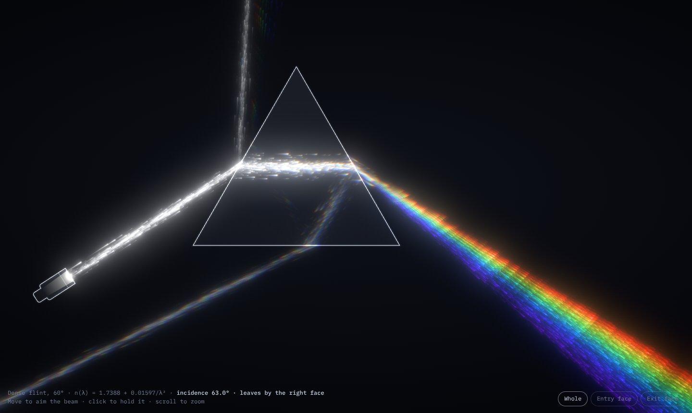
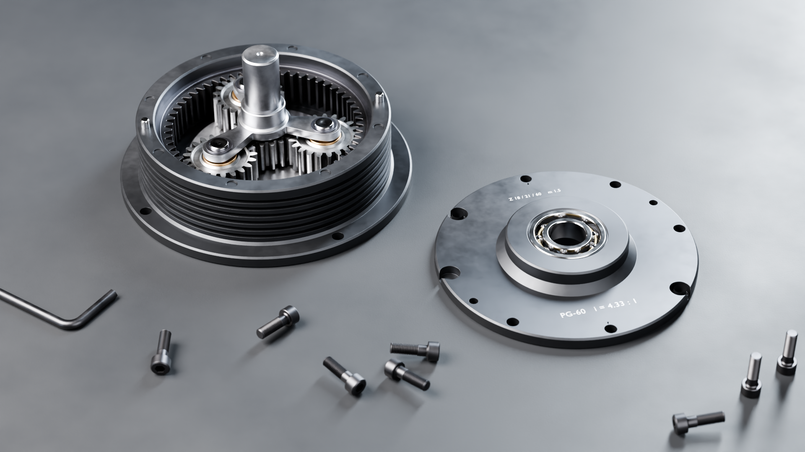

# 3d

Real-time 3D for the web: light traced exactly through a glass prism, plus Blender renders of a working planetary gearbox. Each web piece is a single HTML file with no build step.

## Pieces

### Glass Prism — [`prism/`](prism/)

One flint-glass prism and a lamp throwing white light at it. Each of about 100,000 photons is traced through the glass on an exact ray, refracted by its own wavelength, so the beam splits into a spectrum where it leaves the glass and nothing ever clips through a surface. Raw WebGL, no library.



### Planetary Gearbox — [`planetary-gearbox/`](planetary-gearbox/)

A planetary gear stage modelled and rendered in Blender: a hero still, a close-up and a short animation of the gears running.



## Viewing

```sh
git clone https://github.com/lawyki/3d && cd 3d
python3 -m http.server 8000
# open http://localhost:8000/prism/
```

## License

- **Code** (HTML, CSS, JavaScript, shaders): [MIT](LICENSE-MIT).
- **Visual work** (the pages as designed works, stills, renders and video): [CC BY-NC 4.0](LICENSE-CC-BY-NC-4.0).

Details in [LICENSE](LICENSE).
